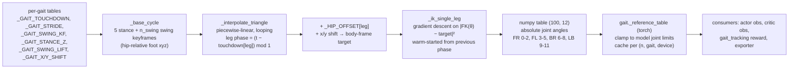

# Optional Lab 2: reference bootstrapping and multi-gait distillation

Lab notebook. Code lives in this fork. Every training run is
`python scripts/opt_lab2/train.py <task> ...` at a recorded commit, logged to W&B
project `deveshaggarwal100-stanford/mjlab`.

## Part 0: Spelunking

All paths are under `src/mjlab/tasks/pupper_gait/`. Line numbers are at commit
`ee0d187`.

### 0.1 The parametric pipeline (gait parameters → `(100, 12)` table)



- **Keyframes** (`mdp/gait_reference.py:242`). Stance has five keyframes sliding
  the foot from `+front` to `−back` at depth `stance_z`: x = front, front/2, 0,
  −back/2, −back. The swing then returns the foot to the front.
  - `n_swing = 1` (the default) gives a single apex at `(0, 0, z + lift)`.
  - `n_swing > 1` spaces the swing keyframes evenly fore-aft, with height
    `z + lift·sin(πk/(n_swing+1))`.
  - With `K = 5 + n_swing` keyframes, each interval is `1/K` of the cycle and the
    stance spans 4 intervals, so **duty factor = 4/K**. That is 0.667 for
    `n_swing = 1`, and 0.286 with a suspension phase for `n_swing = 9`.
- **Leg coordination**. One shared foot cycle. Each leg reads it at
  `(t − touchdown[leg]) mod 1`, so the leg lands at its touchdown phase.
- **Hip offsets** (body frame, m). FR `(0.06, −0.09, 0)`, FL `(0.06, 0.09, 0)`,
  BR `(−0.11, −0.09, 0)`, LB `(−0.11, 0.09, 0)`. Per-leg `_GAIT_X_SHIFT` and
  `_GAIT_Y_SHIFT` are added on top (both empty by default).
- **IK** (`:289`). Central finite-difference gradient (eps 1e-3) on the squared
  FK error, learning rate 10, at most 100 iterations, stopping when the mean
  absolute error < 1e-4 m. Each phase is warm-started from the previous phase's
  solution, so the solution stays on one continuous branch.
- **Joint-limit clamping** is *not* in the numpy generator for parametric gaits.
  It happens in torch, `mdp/gait.py:74` `_reference_table`, which every consumer
  goes through, including the exporter (`export.py:215`). The numpy
  `_clamp_to_joint_limits` is applied only to the captured jump.
- **Fallback** (`:357`). Any gait name without a `_GAIT_TOUCHDOWN` entry plays the
  trot. That is how the fast slot (`reach`, `reach_back`) plays the trot out of
  the box.
- **Reach budget** (comment at `:181`). The leg reaches 0.1734 m from the hip, so
  at `stance_z = −0.14` only ~0.102 m of forward travel is left. Crouching trades
  height for stride.
- **What ships**. Only `trot` (touchdown `(0, .5, .5, 0)`, half-stride 0.05,
  stance −0.14, lift 0.09) plus our `lift` (the same values but stride 0). The
  "gallop" (BL→BR→FR→FL) and "cheetah" (non-lead fore → lead fore → non-lead
  hind → lead hind, 9 swing keyframes) gaits the lab mentions survive only as
  comments (`:135-153`), not as table entries.

Trot no-slip speed, as a sanity check: 2 × 0.05 m of stance travel over a stance
lasting `(4/6) × 0.75 s` gives **0.2 m/s**. The fast band starts at 0.5 m/s and
runs to 1.5 m/s, 2.5–7.5× what the trot reference implies.

### 0.2 The capture socket contract

| | `reach` / `reach_back` (fast slot) |
| --- | --- |
| File | `mdp/captured_reach_gaits.npz` (`_CAPTURED_GAITS_FILE`, next to `gait_reference.py`). Not shipped. |
| Activation | The file's existence. When present, **both** keys are read: a missing key raises `KeyError` at env construction, because `mixed_gait_tracking.__init__` warms all four tables. |
| Keys | `reach_fwd` → gait `reach` (vx ≥ +0.5) and `reach_back` → gait `reach_back` (vx ≤ −0.5). Extra keys are ignored, so provenance metadata can live here. |
| Array | float, shape `(n, 12)`, **absolute** joint angles in rad, `JOINT_NAMES` order FR, FL, BR, LB × (motor 1, 2, 3). |
| Indexing | Row `i` is phase `i/n` of one cycle. Periodic: row `n` ≡ row 0, so don't duplicate the endpoint. |
| Resampling | If `n ≠ 100`: periodic linear interpolation onto `i/100` (row 0 is appended at phase 1 before `np.interp`). |
| `reach_back` | Store it **in natural (forward-running) time order**. The loader pre-reverses it (`np.roll(table[::-1], 1)`, `:354`), so the pipeline's backward time-reversal plays it back exactly as captured. |
| Post-load | The torch table is clamped to the joint limits (as above). The exporter ships `reach` as `gallop_table` and `reach_back` as `gallop_back_table`. |
| Clock | Captured at, and played at, `GAIT_FREQUENCY × _GAIT_FREQ_MULT["reach"]`. |

A second socket feeds the jump tasks: `mdp/captured_jump_gait.npz` with key
`jump` `(n, 12)` (one-shot, *not* periodic: the endpoints are kept and there is
no wrap, `:329`) and `duration_s`.

**Capture detail to get right (Part 2).** The reward grades `q(k)` against the
reference at `k − GAIT_REWARD_PHASE_LEAD_STEPS` = `k − 1.8` control steps (1 step
plus a 4-physics-step action latency ÷ decimation 5; `pupper_gait_env_cfg.py:227`).
A capture indexed by reward phase reproduces exactly what the policy was graded
toward. A capture indexed by raw episode phase is shifted by 1.8 steps, which
is harmless only because a constant phase shift of a periodic gait is
unobservable at deploy.

### 0.3 Command → reference selection (`mdp/mixed_gaits.py:55`)

```
translating = |vx| >= 0.05                      (_DIR_THRESHOLD, gait.py:46)
fast        = translating and |vx| >= 0.5       (TROTGALLOP_ONSET)
reference   = fast ? (vx >= 0 ? reach : reach_back)
            : translating ? trot
            : lift                              (pure turn / pure sidestep)
```

| Constant | Value | Where |
| --- | --- | --- |
| Command range vx / vy / yaw | ±1.5 m/s / ±0.5 m/s / ±2.0 rad/s | `MIXED_MAX_LIN_VEL_X` `pupper_gait_env_cfg.py:117`, applied at `:475`; vy/yaw from the base velocity task |
| Command resample | every 3–8 s; 2% standing, 15% forward-only, 15% turn-only (min 0.5 rad/s) | `twist` command cfg |
| Fast onset | \|vx\| ≥ 0.5 m/s | `TROTGALLOP_ONSET` `:108`, passed at `:477` |
| Direction threshold | \|vx\| ≥ 0.05 → "translating" | `_DIR_THRESHOLD` `gait.py:46` |
| Base clock | 1/0.75 s = 1.333 Hz; control dt 0.02 s (0.004 × decimation 5) → 37.5 steps/cycle | `GAIT_CYCLE_S` `:44` |
| Fast clock multiplier | `_GAIT_FREQ_MULT.get("reach", 1.0)` = **1.0** (empty) | `gait_reference.py:201`, read at `mixed_gaits.py:76`. `GAIT_GALLOP_FREQ_MULT = 2` (`:81`) is **not** used by MixedGaits. |
| Phase | `frac(episode_step × 0.02 × f)` | `mixed_gaits.py:82` |
| Time reversal | `dir = vx` if translating, else `yaw`; `dir < 0` → `eff_phase = frac(−phase)` | `:85-86` |
| Blend to stand | `offset = clamp(‖(vx, vy, yaw)‖ / 0.1, 0, 1) × (ref − default)` | `GAIT_BLEND_SPEED` `:49` |
| Table resolution | 100 samples, linear lookup | `GAIT_N_SAMPLES` `:52` |
| Tracking reward | `exp(−mean((q − ref)² / std²))`, std motor1 0.15 / motor2 0.3 / motor3 0.3 | `GAIT_STD` `:152` |
| Reward phase lead | 1.8 control steps | `:227` |
| Height reward | target 0.145 m, std 0.05; std 10 (off) for \|vx\| ≥ 0.5 | `base_height` cfg |
| Fall-over | 45° (trot tasks: 30°) | `MIXED_FELL_OVER_LIMIT_ANGLE` `:123` |
| `roll_asymmetry` | EMA (τ = 0.3 s) of the motor-2 L+R pair sums, front and back; mean of squares; weight 0 by default | `mixed_gaits.py:166`, `:481` |
| Airborne pretraining | first 500 iterations: base pinned at 0.30 m, only `gait_tracking` rewarded | `GAIT_PRETRAIN_ITERS` `:145` |
| Observation | actor: 36 proprio + 12 reference offset = 48, history 20; critic also gets the offset | `_apply_mixed_reference` `:399` |

**Seams to watch in Part 3.**
- Phase is computed from absolute episode time × `f`. With a fast multiplier
  ≠ 1, crossing 0.5 m/s mid-episode makes the phase *jump*: the fast and slow
  clocks disagree everywhere except t = 0. With the shipped multiplier of 1.0
  there is no jump, only a table swap at the same phase.
- A pure sidestep (`|vx| < 0.05`, yaw ≈ 0) plays `lift` forward (`dir = yaw ≥ 0`).
  A negative turn plays it time-reversed.

## Part 1: Fast gait

Baseline: stock trot in the fast slot, W&B run `mf30kejh` (commit `ee0d187`),
running.
